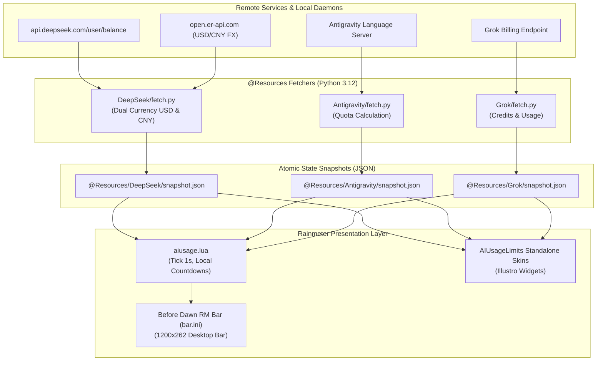

# AI Usage Limits & Before Dawn RM Bar

Rainmeter skins and unified desktop bar for AI coding plan limits and balances — featuring **DeepSeek API credits**, **Antigravity Gemini quota**, and **Grok SuperGrok billing** (with legacy **Claude Code** support).

[](https://github.com/Sto3IV/claude-usage-rainmeter/releases/latest)
[](LICENSE)

---

## Overview

This repository provides two ways to track your AI development usage and quotas on your desktop:

1. **Before Dawn RM Bar** (`Skins/Before Dawn RM Bar/`): A single unified horizontal desktop bar (1200×262) embedding system hardware monitors on the left, live AI usage panels in the center, and a digital clock/date on the right.
2. **AIUsageLimits Standalone Widgets** (`Skins/AIUsageLimits/`): Modular, independent [illustro](https://docs.rainmeter.net/manual/installing-skins/)-style floating widgets that can be positioned anywhere across multiple displays.

| Provider / Skin | Shows | Data Refresh | Source / Backend |
| --- | --- | --- | --- |
| **DeepSeek** | **USD Balance** (top) + **CNY Balance** (bottom) | every **5 min** | `api.deepseek.com/user/balance` with live FX conversion |
| **Antigravity** | Session (5h) + Weekly (7d) Gemini quota | every **5 min** | Local Antigravity language server |
| **Grok** | Weekly SuperGrok used | every **5 min** | Grok CLI billing endpoint, falling back to local session |
| *Claude (Legacy)* | Session (5h) + Weekly (7d) used | every **2 min** | `api.anthropic.com/api/oauth/usage` |

---

## Before Dawn RM Bar

The integrated bar places all three active AI services directly into your desktop aesthetic:

- **Left Block**: System CPU, RAM, and Disk graphs.
- **Center Panels (3 inline)**:
  - **DEEPSEEK** (Blue accent `#4D6BFE`):
    - Top row: **USD Balance** (`$16.24`) with top-up status.
    - Bottom row: **CNY Balance** (`¥108.34`) with live conversion rate.
  - **ANTIGRAVITY** (Cyan/Teal accent `#00FFFF`):
    - Top row: 5-hour rolling session quota bar + countdown to reset.
    - Bottom row: Weekly 7-day quota bar + countdown to reset.
  - **GROK** (White/Gray accent `#E0E0E0`):
    - Single compact weekly billing bar + countdown.
- **Right Block**: Typography clock and date, anchored cleanly at bottom margin `y=237`.

A single Lua controller (`Skins/Before Dawn RM Bar/@Resources/aiusage.lua`) drives all panels: it monitors JSON data snapshots, computes reset countdowns locally every second, and invokes background fetchers on dedicated timers without freezing the UI.

---

## Standalone Illustro Widgets

If you prefer separate floating panels:

- **DeepSeek Widget** (`210×144`): Shows top-line USD balance and bottom-line CNY balance with custom progress bars and conversion details.
- **Antigravity Widget** (`210×144`): Illustro styling for 5h/7d Gemini quotas.
- **Grok Widget** (`210×94`): Illustro styling for weekly SuperGrok usage.
- **Claude Widget** (`210×144`): Legacy widget for Anthropic usage.

---

## Key Features

- **Dual-Currency DeepSeek Balances**: Automatically presents balance in USD (`$`) on top and CNY (`¥`) on bottom. If the account only holds one currency, the engine dynamically calculates the counterpart using live market exchange rates (`open.er-api.com`) with an offline static fallback.
- **Second-Precision Countdowns**: Quota reset timers update every second locally without pinging remote APIs.
- **Resilient Carry-Forward Contract**: A transient network timeout or HTTP error **never blanks the skin or displays fake zero values**. The last known valid balance and quota readings remain visible on screen, annotated with staleness indicators (`stale`, `offline`, `1h old`).
- **Asynchronous Headless Execution**: Python fetch scripts are executed through Rainmeter's `RunCommand` plugin hidden in the background, preventing desktop lag or terminal popping.
- **Zero Secret Leaks**: No tokens or passwords are ever stored inside skin config files or Git repositories.

---

## Authentication & Secret Hygiene

Each fetcher automatically loads credentials from local environment variables or standard CLI config locations:

| Service | Environment Variable | Configuration File Fallback |
| --- | --- | --- |
| **DeepSeek** | `DEEPSEEK_API_KEY` | `%USERPROFILE%\.deepseek\credentials.json` (`{"api_key": "sk-..."}`) |
| **Grok** | `GROK_AUTH` or `XAI_API_KEY` | `%USERPROFILE%\.grok\auth.json` |
| **Antigravity** | Auto-detected | Local Antigravity language server process |
| **Claude** | `CLAUDE_CODE_OAUTH_TOKEN` | `%USERPROFILE%\.claude\.credentials.json` |

### Setting Up DeepSeek API Key

To configure your DeepSeek API credits tracker, choose either:

1. **Option A (Environment Variable)**:
   ```powershell
   [System.Environment]::SetEnvironmentVariable('DEEPSEEK_API_KEY', 'sk-your-key-here', 'User')
   ```
2. **Option B (Credentials File)**:
   Create `%USERPROFILE%\.deepseek\credentials.json`:
   ```json
   {
     "api_key": "sk-your-key-here"
   }
   ```

---

## Requirements

- **OS**: Windows 10 or Windows 11 (64-bit)
- **Rainmeter**: [Rainmeter 4.5+](https://www.rainmeter.net/)
- **Python**: [Python 3.10+](https://www.python.org/) with `py` launcher in PATH
- **Fonts** (for Before Dawn Bar typography):
  - [Inter](https://fonts.google.com/specimen/Inter)
  - [Fira Code](https://fonts.google.com/specimen/Fira+Code) (monospaced numbers ensure column alignment)
  - [Jost](https://fonts.google.com/specimen/Jost)
  - [Montserrat](https://fonts.google.com/specimen/Montserrat)

---

## Installation

### Manual Installation

1. Copy the `Skins` directory contents into your Rainmeter skins folder:
   - `Skins\AIUsageLimits` &rarr; `%USERPROFILE%\Documents\Rainmeter\Skins\AIUsageLimits`
   - `Skins\Before Dawn RM Bar` &rarr; `%USERPROFILE%\Documents\Rainmeter\Skins\Before Dawn RM Bar`
2. Right-click the Rainmeter tray icon &rarr; **Refresh all**.
3. In the Rainmeter Manage window:
   - To use the unified bar: Load **Before Dawn RM Bar &rarr; bar.ini** (keep `AIUsageLimits` skins set to `Active=0` as the bar executes the fetchers directly).
   - To use standalone widgets: Load the desired skins under `AIUsageLimits\*`.

---

## Verification & Testing

All fetch engines and data parsing contracts include comprehensive automated unit tests verifying error recovery, payload parsing, currency calculation, and backoff handling:

```powershell
# DeepSeek balance fetcher test suite (17 tests)
py -3 -m unittest discover -s Skins/AIUsageLimits/DeepSeek/tests

# Antigravity Gemini quota test suite (22 tests)
py -3 -m unittest discover -s Skins/AIUsageLimits/Antigravity/tests

# Grok billing test suite (18 tests)
py -3 -m unittest discover -s Skins/AIUsageLimits/Grok/tests

# Claude legacy test suite (32 tests)
py -3 -m unittest discover -s Skins/AIUsageLimits/Claude/tests
```

All 89 unit tests run hermetically with zero external network calls using pre-recorded fixtures.

---

## Architecture & Data Flow



---

## License

MIT License. See [LICENSE](LICENSE) for details.
